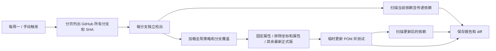

> 2026-10-14 更新：以下内容保留为旧实现记录。当前执行契约、脚本和配置以 `docs/weekly-dependencies.md`、`.github/workflows/weekly-dependencies.yml`、`.github/dependency-policy.json` 与 `scripts/dependencies/check_dependencies.py` 为准；每个分支均保留 CI，读取目标分支策略。下文已退役的 Renovate/旧脚本路径不再作为运行指引。

# 每周全分支依赖检查设计

- 日期：2026-10-14
- 状态：本地实现已完成，基线单测有现有失败；远端运行及启用待验证
- 目标：每周检查 GitHub 所有分支的当前依赖漏洞与最新正式版兼容性。

## 范围与设计

固定版本通过 Maven 版本属性配置；排除依赖通过 `groupId:artifactId` 通配符或版本属性配置。排除坐标关联的属性整体保护，避免共享属性间接改动排除依赖。按分支 glob 覆盖策略，固定属性和显式排除属性冲突时失败。

检查所有 GitHub 远端分支，包括 opt/ 和 agent 分支，无需在每个分支安装 workflow。控制器从触发工作流的版本加载，目标代码单独检出且按列出的 SHA 检查。定时调度要求 workflow 存在于 GitHub 默认分支。不创建/切换本地分支，不自动提交、推送、发布或合并更新。

版本查询使用 Maven Versions Plugin；跨大版本开放，过滤 SNAPSHOT/alpha/beta/RC/M/EA 等预发布。更新当前仓库显式管理的依赖、BOM 和关联属性，外部父 POM/BOM 的内部版本由上游管理，不将其原地篡改。`io.ddd4j` 和本仓库 reactor 依赖属于分支兼容性契约，作为明确排除配置；传递依赖仍参与漏洞扫描。

漏洞扫描采用 OWASP Dependency-Check aggregate，当前依赖和候选依赖都检查，CVSS >= 7 失败；固定和排除只影响更新，不影响扫描。数据库下载或解析故障必须失败，不能输出无漏洞通过。最新版本不能保证没有漏洞，扫描也不能保证发现全部漏洞。

## 验收

- Python 策略测试覆盖固定、排除共享属性、分支覆盖、错误配置；actionlint 检查 workflow。
- 每周一 03:17 UTC（北京时间 11:17）；分页发现分支，独立矩阵且 fail-fast=false。
- Maven 3/4 wrapper、JDK 由目标分支决定；已有 MAVEN_SETTINGS_XML 用于私有依赖。
- 保留 baseline/candidate 漏洞报告、POM diff、测试报告和日志，失败时也上传。
- 远端各分支 Maven 更新/单测/漏洞扫描和真实定时运行必须有独立证据；本地控制器测试不能替代。
