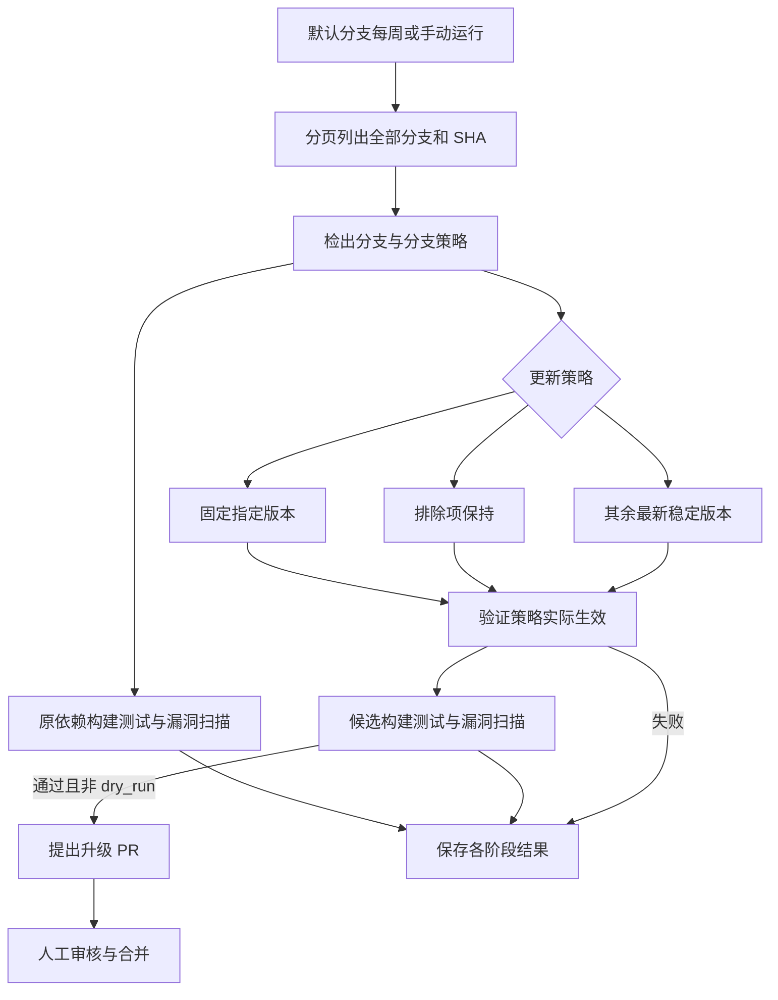

# 每周全分支依赖维护统一契约

日期：2026-10-14。本文件为此次跨仓库 CI 修正的规格事实源，延续已有工程文档，不初始化新的规格体系。

## 行为与验收

- 五个仓库共用 `.github/workflows/weekly-dependencies.yml`、`scripts/dependencies/check_dependencies.py` 和控制器测试；仅 `.github/dependency-policy.json` 体现组件差异。每个本地和 GitHub 分支保留这套文件。
- 每周一北京时间 10:17（UTC 02:17）调度。GitHub schedule 仅在默认分支触发；控制器分页枚举全部分支及 SHA，按不可变 SHA 检出。feature、fix、opt、agent、backup 全部纳入；仅排除本 CI 生成的 `automation/dependencies/`，避免递归。超过 256 分支显式失败，不截断。
- 使用被检查分支的策略文件；分支可独立调整。`branches` 使用 glob，按配置顺序合并，后面的固定版本覆盖前面的固定版本，排除列表累加。
- 固定版本优先于排除：`fixed_properties` 或 `fixed_dependencies` 强制指定版本，允许降级；`exclude` 和 `exclude_properties` 保留版本；其余源码控制的依赖、BOM、外部父版本使用仓库可取得的最新稳定版本，允许 major/minor/patch。项目版本、Java/Maven 工具链及 reactor 版本保持原契约。不在 POM 使用 LATEST。
- Versions Maven Plugin 2.23.0 更新属性和依赖字面量。外部父 POM 中本项目显式引用的版本属性，从 effective POM 解析后在根 POM 覆盖；排除项及共享属性受保护。BOM 隐式管理及传递依赖通过 BOM 升级取得版本，不改写上游 BOM。非属性形式的构建插件升级不在本次依赖更新范围。
- 先构建/测试并扫描当前依赖，再在临时检出中更新、构建/测试并扫描候选。固定项和排除项仍参与直接、传递、test、provided 漏洞扫描。扫描使用 Java 21，构建沿用分支 JDK 和 Wrapper；无 Wrapper 使用经 SHA-512 校验的 Maven 3.9.16 / 4.0.0-rc-7。
- CVSS >= 7、构建/测试失败、策略未生效、解析或扫描失败、报告丢失或为空均失败。即使候选通过，原依赖漏洞仍保留失败状态。兼容旧工程时禁用 Enforcer，因此不能宣称通过完整发布门禁；已有独立发布/安全 CI 保留。
- 无根 POM 分支记录 `not-applicable-no-maven-project`，不宣称完成 Maven 扫描。每分支记录 SHA、阶段日志、策略、补丁、扫描报告和单元测试报告，失败也上传，保留 30 天。
- push/PR 仅运行无凭据控制器测试与策略校验；schedule/手动运行检查全部分支。手动 `dry_run` 默认 true，仍更新临时 POM、构建和扫描，但不创建 PR。定时任务仅为通过的候选提出升级 PR，不自动合并。合并后源码依赖才真正更新。

## 配置示例

```json
{
  "exclude": ["io.ddd4j*:*"],
  "exclude_properties": ["ddd4j*.version"],
  "fixed_properties": {"guava.version": "33.4.8-jre"},
  "fixed_dependencies": {"commons-io:commons-io": "2.19.0"},
  "cvss_threshold": 7,
  "branches": {
    "feature/legacy*": {"fixed_properties": {"guava.version": "31.1-jre"}}
  }
}
```

固定属性/坐标必须存在并最终生效，否则失败。共享属性冲突不能绕过排除：应统一固定相关属性或调整明确策略。示例只演示格式，不是项目推荐版本。

## 现有兼容策略

- ddd4j：沿用原先排除的 Spring、Jackson 2/3、内部 ddd4j 和 Easy4J；有 Disruptor 的分支按 JDK 8 固定 3.4.4、JDK 17/21 固定 4.0.0。
- Boot：沿用原先排除的 Spring、Jackson 2/3 和内部 ddd4j。
- Javalin：沿用原先排除的 Javalin/OpenAPI 和内部 ddd4j。
- Quarkus：`feature/3.3.x` 固定 Quarkus BOM 属性 3.37.4，`feature/4.0.x` 固定 3.38.2，引用该属性的插件一并保持；排除内部 ddd4j。Quarkiverse 扩展有独立版本，不随平台版本强行固定。
- Cloud：沿用原先排除的 Spring、Alibaba Cloud、内部 ddd4j 和对应版本属性。

删除这些显式规则后相应依赖进入默认最新稳定版本更新；这些规则不豁免漏洞扫描。

## 凭据与运行

- `MAVEN_SETTINGS_XML` 兼容原文 XML 和 base64 XML。私有仓库需相应认证；不将凭据写入 artifact。
- 推荐 `NVD_API_KEY`。未设置则使用公共限流下载，可能超时；下载失败不会当成无漏洞。
- 可选 `DEPENDENCY_UPDATE_TOKEN` 或现有 `RENOVATE_TOKEN`，用于使升级 PR 触发已有 CI。没有时使用 GITHUB_TOKEN，需仓库允许 Actions 创建 PR；其提交不触发普通 push/PR 工作流，本工作流已验证候选。



## 验证边界

控制器单测、actionlint、全分支 POM/策略/工具链检查和真实 Maven 微型项目更新，与各分支完整构建和 NVD 扫描是不同证据。本地检查不证明全部分支无漏洞；完整运行需检查各分支扫描及构建报告。
